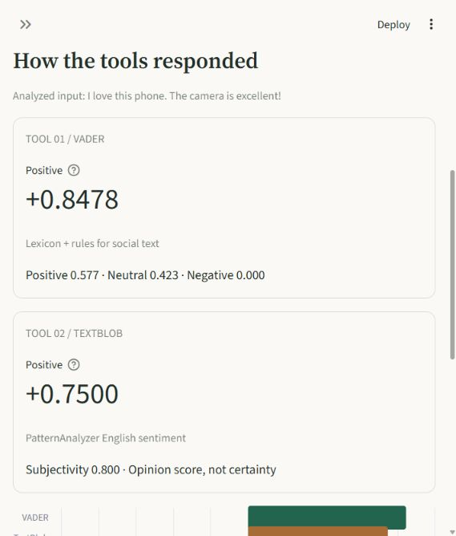
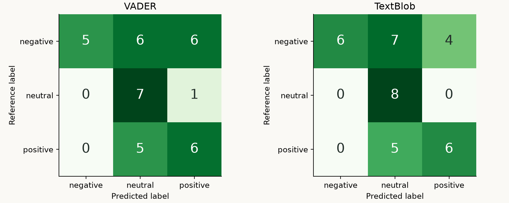

# Sentiment analysis in context

**Rizvi College of Engineering**
Department of Artificial Intelligence & Data Science
**ANSARI JAFEERA JAMIL AHMED | UIN: 231A022 | Roll number: 03**
NLP application study: social-media sentiment and product feedback.

A working Streamlit lab compares two real NLP tools, VADER and TextBlob, on the same inputs. It includes a 36-input challenge set, measured output comparisons, confusion matrices, an executed notebook, screenshots, a report and a Hindi/Hinglish sentiment adapter with an extension plan.

## Run the app

Use Python 3.12, the version used for verification. Open a terminal in `sentiment-analysis`:

```powershell
python -m venv .venv
.venv\Scripts\python -m pip install -r requirements.txt
.venv\Scripts\python -m streamlit run app.py
```

Open http://127.0.0.1:8501. On macOS/Linux, replace `.venv\Scripts\python` with `.venv/bin/python`.

Inference runs locally after installation. No API keys, model downloads, translation service or NLTK corpus download is required for the sentiment operations used here. Other TextBlob operations, such as POS tagging, can require additional corpora; this project does not call them. Run Streamlit from this directory so it loads the project theme.

The app has four views:

- Try the tools: choose an example or type a custom input. Automatic language routing selects the Hindi adapter for Hindi/Hinglish; English inputs use VADER and TextBlob. Inspect matched words and download JSON.
- Compare 36 inputs: accuracy, category chart, searchable error table, confusion matrices and CSV/JSON downloads.
- Hindi sentiment: the implemented dictionary, negation rules, code-switching, script variation and resources for extending coverage.
- Project & report: requirement coverage, reproduction commands and the PDF download.



## What the experiment found

| Tool | Accuracy | Macro F1 | Correct inputs |
|---|---:|---:|---:|
| VADER 3.3.2 | 50.0% | 0.498 | 18/36 |
| TextBlob 0.20.1, PatternAnalyzer | 55.6% | 0.555 | 20/36 |

The tools disagree on four inputs. Both get all six straightforward English examples and all six negation examples right, under the declared references. Both miss all six sarcastic complaints. In the original two-tool benchmark, both label every Hindi and Hinglish input neutral, including opinions. The updated app adds a separate Hindi lexicon adapter that passes all 12 illustrative Hindi/Hinglish checks. Its dictionary was developed with these examples available, so those checks are not an independent accuracy estimate.

Labels use full-precision scores. SA03's TextBlob polarity is `0.04999999999999999`, just below `0.05`, so it is neutral under the strict comparison even though a four-decimal display reads `0.0500`. That disagreement includes a floating-point boundary effect and should not be treated as a robust linguistic difference. No epsilon or display rounding is applied before classification.

These are measurements on a small, deliberately difficult, project-authored set. An always-negative baseline gets 47.2% accuracy. This comparison does not establish broad superiority or production readiness. See [dataset construction and label ambiguities](data/README.md).



## Read the submission

- [Assignment report, PDF](reports/sentiment_analysis_report.pdf)
- [Assignment report, Markdown](reports/report.md)
- [Executed notebook](Sentiment_analysis_experiment.ipynb)
- [All inputs and reference meanings](data/challenge_set.csv)
- [Complete output comparison](results/comparison.csv)
- [Metrics and confusion matrices](results/metrics.json)
- [Versions, thresholds and dataset checksum](results/provenance.json)
- [Hindi implementation and extension plan](docs/hindi_adaptation.md)
- [Presentation and viva notes](docs/presentation_notes.md)
- [Actual app screenshots](reports/screenshots)

## Reproduce and verify

Using the same virtual environment:

```powershell
.venv\Scripts\python -m pip install -r requirements-dev.txt
.venv\Scripts\python -m scripts.evaluate
.venv\Scripts\python -m scripts.evaluate_hindi
.venv\Scripts\python -m pytest -q
.venv\Scripts\python -m scripts.build_notebook
.venv\Scripts\python -m scripts.build_report
```

`evaluate` runs both tools and writes results and figures. `build_notebook` executes every code cell in the current environment. `build_report` uses measured JSON and the checked-in screenshots to regenerate the report. Capture new screenshots manually if the UI or dataset changes; they are real UI evidence, not generated mockups.

Tests check label boundaries, input validation, negation, Hindi behavior, hand-computed metrics, duplicate IDs, reproduction of committed measurements, custom input submission, filtering, empty search results and page rendering. GitHub Actions runs these checks on Python 3.12 after a push.

## Method and limitations

Positive is score >= +0.05, negative is score <= -0.05, and neutral is between those boundaries. These are VADER's documented cutoffs; using the same values for TextBlob is a project decision. The tools' scores have different semantics and are not calibrated. Subjectivity is not confidence, and VADER's token sentiment proportions are not class probabilities.

The VADER/TextBlob benchmark retains original punctuation, case and script. The Hindi adapter uses NFC normalization and a project-authored sentiment dictionary with negation and intensity rules. The reference labels were assigned during dataset construction with AI assistance, without independent annotation or native-speaker validation. Full provenance is in [data/README.md](data/README.md). The implemented Hindi adapter and its extension plan are documented separately from the original English-tool measurements.

The uploaded assignment image is cropped after the socio-linguistic challenges subpart. The project covers every visible requirement; unseen continuation text was not available.

## Repository layout

```text
app.py                         Streamlit entrypoint
app_pages/                     Four application views
sentiment_lab/                 NLP, evaluation and shared UI helpers
data/                          Original examples and annotation notes
scripts/                       Evaluation, report and notebook reproduction
results/                       Measured CSV/JSON and provenance
reports/                       PDF, Markdown, figures and UI screenshots
docs/                          Adaptation plan and presentation notes
tests/                         Automated verification
```

The existing experiment notebooks in the parent repository are retained. The application and reproduction scripts operate on local files.

## Sources

- Hutto and Gilbert, 2014. [VADER paper and implementation](https://github.com/cjhutto/vaderSentiment).
- [TextBlob sentiment documentation](https://textblob.readthedocs.io/en/stable/quickstart.html#sentiment-analysis) and [PatternAnalyzer API](https://textblob.readthedocs.io/en/stable/api_reference.html).
- [AI4Bharat IndicBERT](https://indicnlp.ai4bharat.org/pages/indic-bert/), proposed pretrained encoder for Hindi fine-tuning.
- [IndicXlit](https://github.com/AI4Bharat/IndicXlit), proposed transliteration resource.
- [IndicTrans2](https://github.com/AI4Bharat/IndicTrans2), optional translation baseline.

This project contains AI-assisted implementation, documentation and illustrative test inputs. Results were generated by running the named tools locally; screenshots were captured from the running application. Review and understand the material before presenting it.
