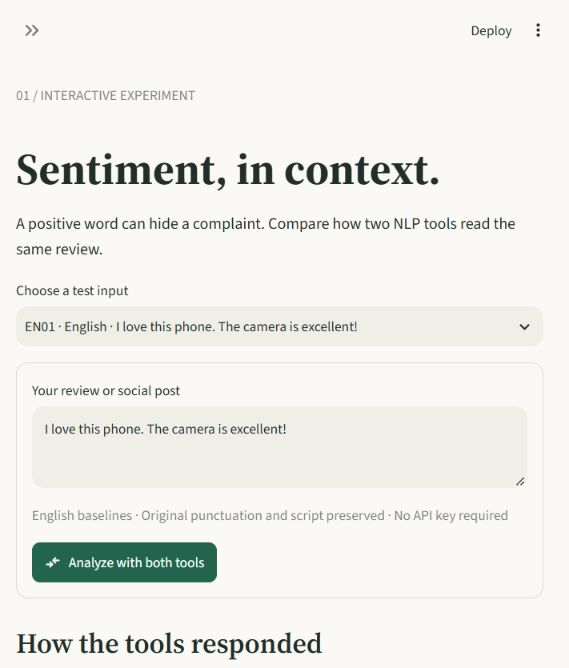
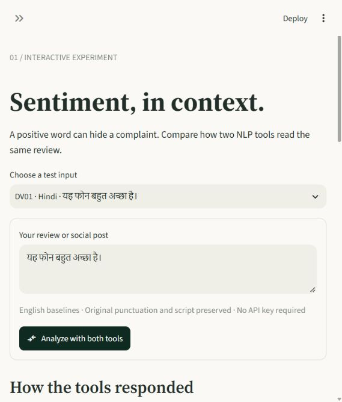
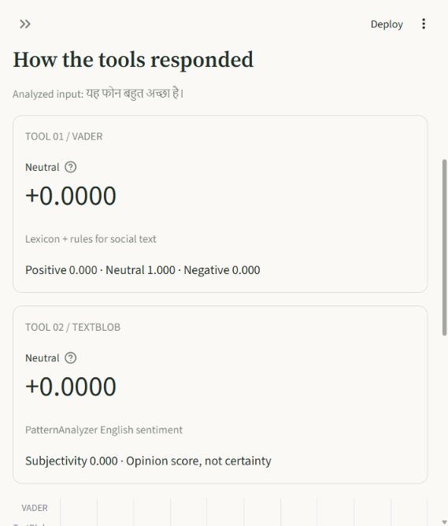

# RIZVI COLLEGE OF ENGINEERING

## Department of Artificial Intelligence & Data Science


## Project report: Sentiment analysis

Natural Language Processing (CSDO7011)

**ANSARI JAFEERA JAMIL AHMED | UIN: 231A022 | Roll number: 03**
NLP application study | 24 October 2026

## Aim and scope

This study tests sentiment analysis for product feedback and social posts using two existing tools, VADER and TextBlob. It compares their actual local outputs on the same 36 project-authored inputs and implements a separate Hindi/Hinglish lexicon adapter. The original tools succeed on simple English cases but miss sarcastic complaints and Hindi sentiment. The adapter adds Hindi vocabulary, negation and intensity rules.

The report covers all requirements visible in the uploaded assignment: a real tool trial with input/output snapshots, a same-input comparison of two tools, an error matrix, cultural/regional analysis, and a Hindi adaptation proposal addressing linguistic resources and socio-linguistic challenges. The supplied image ends after the socio-linguistic subpart; unseen continuation text was not available.

## Tools, inputs and procedure

The two tools receive the original text field, with no translation, transliteration, spelling correction, lowercasing or stopword removal. Only outer whitespace is stripped for custom inputs. VADER uses its distributed lexicon and rules; TextBlob uses its default English PatternAnalyzer. The original comparison uses the distributed package versions and declared fixed thresholds.

Positive means score >= +0.05, negative means score <= -0.05, and neutral falls between. The cutoffs follow VADER's documented recommendation. Applying the same cutoffs to TextBlob is an explicit project choice. VADER compound and TextBlob polarity have different scoring semantics, so their magnitudes are not directly calibrated. Subjectivity is not certainty; token sentiment proportions are not class probabilities.

The set contains six inputs in each of English, Negation, Sarcasm, Indian English, Hinglish and Hindi. Its reference distribution is 17 negative, 8 neutral and 11 positive. Examples and intended labels were prepared with AI assistance before inference, without independent annotation or native-speaker validation. The set deliberately stresses failure modes and is not representative of social-media traffic.

See [all inputs and meanings](../data/challenge_set.csv) and [annotation notes](../data/README.md).

## Tool trial and snapshots

Both tools correctly label all six straightforward English inputs and all six negation examples under the declared references. For EN01, 'I love this phone. The camera is excellent!', VADER returns positive at +0.8478 and TextBlob returns positive at +0.7500. Preserving words such as 'not' allows both tools to label NG01, 'This phone is not good.', negative.




## Measured comparison

| Tool | Correct | Accuracy | Macro F1 |
| --- | --- | --- | --- |
| VADER | 18/36 | 50.0% | 0.498 |
| TextBlob | 20/36 | 55.6% | 0.555 |

TextBlob gets two more inputs correct on this set. Both exceed an always-negative baseline of 17/36, or 47.2%, by a small margin. Four output labels differ. This is a descriptive classroom experiment; the sample size and construction do not support a general ranking of the tools. Accuracy is correct labels divided by inputs. Macro F1 averages the three class F1 values, with undefined values set to zero.

| Category | Inputs | VADER accuracy | TextBlob accuracy |
| --- | --- | --- | --- |
| English | 6 | 100.0% | 100.0% |
| Hindi | 6 | 33.3% | 33.3% |
| Hinglish | 6 | 33.3% | 33.3% |
| Indian English | 6 | 33.3% | 66.7% |
| Negation | 6 | 100.0% | 100.0% |
| Sarcasm | 6 | 0.0% | 0.0% |


Matrix rows are reference labels; columns are predictions, ordered negative, neutral, positive.

## Every disagreement

| ID | Unchanged input | Reference | VADER / score | TextBlob / score |
| --- | --- | --- | --- | --- |
| SA03 | I just love paying for a broken product. | negative | positive / +0.2732 | neutral / +0.0500 |
| SA04 | Fantastic! Another failed payment. | negative | positive / +0.1511 | neutral / +0.0000 |
| IN04 | The restaurant is overhyped and the food is tasteless. | negative | neutral / +0.0000 | negative / -0.6000 |
| IN06 | The shop opens after the Diwali holiday. | neutral | positive / +0.4019 | neutral / +0.0000 |

SA03 and SA04 are sarcasm/context errors for both tools, although their incorrect labels differ. SA03 also has a floating-point boundary effect: the raw TextBlob polarity is 0.04999999999999999, just below 0.05. It is classified neutral using full precision, despite displaying as 0.0500 after rounding. Treat that disagreement cautiously. IN04 is a domain-vocabulary error for VADER. IN06 is a false positive for a factual Diwali schedule. A holiday-word association is a plausible explanation for IN06; the output by itself does not prove cultural reasoning or its cause.

## Successes, errors and regional context

Both tools correctly label all six straightforward English inputs and all six negation examples under the declared references. For EN01, 'I love this phone. The camera is excellent!', VADER returns positive at +0.8478 and TextBlob returns positive at +0.7500. Preserving words such as 'not' allows both tools to label NG01, 'This phone is not good.', negative.

Both tools miss all six sarcastic complaints. SA01 says 'Great! The app crashed again and deleted my work.' The intended negative judgement conflicts with the surface praise. The observed outputs show a pragmatic/context error. They do not establish that either tool can infer the speaker's intent from isolated positive words.

Both tools return neutral for IN01, 'The food was simply paisa vasool.', although the intended reading is positive value for money. Both return neutral for IN03, 'The service is third class.', although the regional judgement is negative. IN02 includes 'I enjoyed it', and both tools succeed; that success alone does not demonstrate that they understood 'timepass'.

All six Hindi inputs and all six Hinglish inputs receive neutral from both tools. Four references in each group are positive or negative, so each tool gets only the two factual inputs right, or 2/6. Correct factual labels here do not show Hindi comprehension. DV01 means 'This phone is very good.' Both scores are zero despite the positive reference. HI04, 'Product accha nahi hai.', means the product is not good, yet both tools return neutral.

Translation errors were not measured because no translation system was used. None of these examples diagnoses grammatical parsing by itself. The observed errors concern lexical coverage, idioms, pragmatics and context.





## Hindi implementation and extension plan

### Hindi support in the app

The app now routes Hindi and Hinglish inputs to **Hindi lexicon + negation**. The dictionary covers Devanagari words and common Romanized variants. It recognizes खराब as negative and अच्छा as positive, reverses sentiment for nearby negation, and strengthens sentiment for words such as बहुत. English sentiment words within mixed-language inputs use VADER's word lexicon.

For `यह सामान बहुत खराब है।`, the adapted result is **negative, -0.7579**. For `Product accha nahi hai`, it is negative. Factual inputs without sentiment words receive zero. The original VADER/TextBlob outputs remain available under Compare original English tools and in the unchanged 36-input benchmark.

The implementation is in `sentiment_lab/hindi.py` and `data/hindi_lexicon.json`. Token scores are summed and normalized as `s / sqrt(s*s + 15)`. Negation changes a matched term's sign with a 0.74 factor; intensifiers multiply it by 1.5. The selected label uses the same +/-0.05 boundaries.

All 12 coursework Hindi/Hinglish checks pass with this dictionary. Their words were available during development, so these are illustrative checks rather than an independent estimate of accuracy. Sarcasm, unfamiliar words and complex negation still need broader evaluation. Automatic routing uses script and dictionary matches; the language selector lets the user override it.

### Resources and their purpose

| Resource | Concrete use | Caveat |
|---|---|---|
| A consented, labeled Hindi and Hinglish review corpus | Supervised sentiment training and held-out evaluation | Build domain coverage; remove identifying details and duplicates |
| Hindi language corpus and a pretrained encoder such as [IndicBERT](https://indicnlp.ai4bharat.org/pages/indic-bert/) | Initialize a classifier before fine-tuning on sentiment labels | Specialize the encoder using sentiment-labeled examples |
| Hindi sentiment lexicon with native-speaker ratings | Transparent baseline covering अच्छा, खराब, पसंद and domain phrases | Context, negation and slang can reverse dictionary meanings |
| Token language identification and Unicode-aware tokenization | Preserve Hindi, English, emoji, URLs and punctuation separately | Script identification alone cannot recognize Romanized Hindi |
| Hindi POS tagging and dependency analysis | Optional error analysis of negation scope and modifiers | A transformer baseline does not require POS tagging |
| [IndicXlit](https://github.com/AI4Bharat/IndicXlit) | Candidate Roman-to-Devanagari normalization | Retain original text; transliteration is ambiguous |
| [IndicTrans2](https://github.com/AI4Bharat/IndicTrans2) | Optional translation-to-English baseline | Translation can change sentiment, idioms or sarcasm; evaluate separately |

### Steps for extending the implementation

1. Collect a proposed pilot of 3,000 consented reviews, targeting 1,000 each in Devanagari Hindi, Romanized Hindi and mixed Hindi-English. Include products, delivery, food and social posts. This is a collection target, not an existing dataset.
2. Write a sentiment annotation guide with positive, negative and neutral labels. Mark sarcasm, mixed aspects, regional expressions and ambiguous cases as separate attributes. Have two Hindi speakers independently label every item and a third adjudicate disagreements. Report agreement before adjudication.
3. Normalize Unicode to NFC, mask identifying details and retain negation, emoji, repeated letters and punctuation. Do not remove stopwords blindly: नहीं, मत and ना can change sentiment. Store both original and normalized forms.
4. Group near-duplicates, conversation threads and reviews from the same source before a stratified 70/15/15 training, validation and test split. Prevent leakage across groups. The 36 coursework examples remain diagnostic examples, not training data.
5. Extend and validate the implemented Hindi lexicon and negation rules. Fine-tune an IndicBERT sentiment classifier on the same training split. Compare optional transliteration and translation pipelines as separate experiments. Never replace the original-text test set with translated text.
6. Choose hyperparameters and any abstention threshold using validation data only. Freeze the test set. Evaluate accuracy, per-class precision/recall/F1, macro F1 and confusion matrices by script, dialect, domain and code-switching level.
7. Add human review for unsupported dialects, ambiguous mixed sentiment and uncertain predictions. Retain an audit trail of model version and preprocessing. Roll out only after native-speaker error review and validation against the baseline.

### Socio-linguistic challenges

| Challenge | Example or consequence | Proposed response |
|---|---|---|
| Romanized spellings | accha, achha, acha; nahi, nahin | Cover spelling variants and compare normalization against original text |
| Code-switching | Product accha nahi hai | Identify token language and learn Hindi negation over an English product noun |
| Regional and social variation | mast, zabardast, paisa vasool vary with usage | Include regional speakers and domain context in annotation and error review |
| Scripts and mixed scripts | Devanagari, Latin and mixtures | Tokenize Unicode safely and publish metrics for each script group |
| Sarcasm and politeness | Praise words may accompany a complaint | Annotate pragmatic intent and retain preceding conversational context where consent permits |
| Mixed aspects | Good camera but poor battery | Record aspect labels or flag a mixed judgement instead of hiding the tradeoff |
| Hindi varieties | Regional Hindi and contact varieties differ | Report subgroup sample sizes; avoid claiming coverage of every dialect |

### How improvement would be demonstrated

Compare all candidate pipelines on the same untouched test IDs, report subgroup support and confidence intervals, and inspect false neutrals in Hindi. A useful model must improve sentiment recall beyond an all-neutral baseline while preserving performance on factual inputs. The current adapter's measured illustrative checks are saved separately in `results/hindi_adapter.json`. A new held-out corpus is needed to assess broader accuracy.


## Limitations

NG04, 'I do not hate this movie.', has a weak-positive reference, but a neutral reading is defensible. NG05 and NG06 contain mixed aspects and use the final product-related clause for the overall label. Sarcasm references are all negative. These annotation choices limit interpretation. The results were not used to revise labels or remove examples.

The demonstration uses synthetic examples rather than scraped Twitter/Facebook data. It is a working application of existing NLP tools, a comparison of distributed English tools plus a local Hindi lexicon adapter. Scores should not be reported as confidence percentages.

## Reproduce the work

```bash
python -m pip install -r requirements-dev.txt
python -m scripts.evaluate
python -m pytest -q
python -m scripts.build_notebook
python -m scripts.build_report
python -m streamlit run app.py
```

Python 3.12.14; VADER 3.3.2; TextBlob 0.20.1. Actual run time in UTC: 2026-10-24T15:11:10.781830+00:00. Dataset SHA-256: `f97d2fff2148304d36c18522b131736c07ed481c2d94b9c0fec8ab67f2ed7764`.

The CSV and predictions JSON preserve every output. Screenshots are actual captures from the running app. The notebook was executed, not populated with invented results. Implementation, illustrative data and documentation were prepared with AI assistance.

## Sources

- [VADER implementation, paper and scoring](https://github.com/cjhutto/vaderSentiment)
- [TextBlob sentiment and API documentation](https://textblob.readthedocs.io/en/stable/quickstart.html#sentiment-analysis)
- [AI4Bharat IndicBERT](https://indicnlp.ai4bharat.org/pages/indic-bert/)
- [AI4Bharat IndicXlit](https://github.com/AI4Bharat/IndicXlit)
- [AI4Bharat IndicTrans2](https://github.com/AI4Bharat/IndicTrans2)

Sources consulted 24 October 2026.
